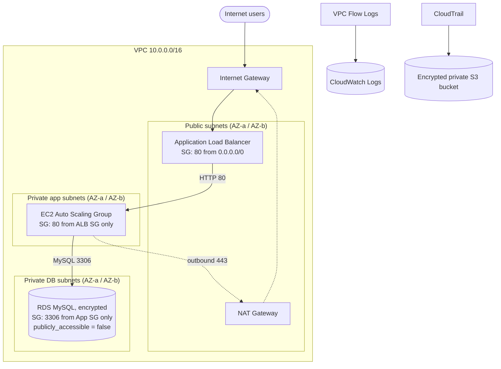

# Secure Three-Tier Application on AWS (Terraform)

## Architecture



## Deploy

```bash
terraform init
terraform fmt && terraform validate
terraform plan -out tfplan
terraform apply tfplan
terraform output alb_dns_name     # open in browser (wait ~3-5 min for targets to be healthy)
```

Clean up when finished (NAT Gateway and RDS cost money):

```bash
terraform destroy
```

## Security controls implemented

| Control | Implementation |
|---|---|
| Network segmentation | 3 subnet tiers; DB route table has no internet route |
| Least-privilege SGs | ALB -> App -> DB chained by security group reference, no CIDR rules for internal tiers |
| DB isolation | `publicly_accessible = false`, private subnets, only App SG can reach 3306 |
| No SSH | Access through SSM Session Manager; no port 22 anywhere |
| Instance hardening | IMDSv2 required, encrypted EBS |
| Secrets | RDS master password managed in Secrets Manager (not in code or state) |
| Encryption at rest | RDS `storage_encrypted`, EBS encrypted, S3 SSE |
| Default SG | Locked down with `aws_default_security_group` |
| Monitoring | VPC Flow Logs (ALL traffic) to CloudWatch; multi-region CloudTrail with log file validation |
| Log bucket protection | Public access block, versioning, TLS-only policy |

## Screenshot checklist (for submission)

1. `terraform apply` complete and `terraform output`
2. VPC resource map (VPC console > your VPC > Resource map)
3. Subnets list showing public / app / db tiers and their AZs
4. Route tables: public (IGW), app (NAT), db (local only)
5. Internet Gateway and NAT Gateway (state: Available)
6. Security groups: inbound rules for ALB, App, DB (showing SG references)
7. ALB details (internet-facing) and target group with healthy targets
8. EC2 instances showing **no public IPv4** address, in app subnets
9. Browser showing the app page via the ALB DNS name
10. RDS details: Public access = **No**, subnet group, security group, encryption enabled
11. Test proving DB isolation: from an app instance via Session Manager, `nc -zv <rds-endpoint> 3306` succeeds; from your laptop it times out
12. VPC Flow Logs configuration and a CloudWatch Logs stream with ACCEPT/REJECT records
13. CloudTrail trail (multi-region, log validation on) and log files in the S3 bucket
14. S3 bucket "Block all public access" = On

## Optional improvements (mention in your report)

- HTTPS listener with ACM certificate and HTTP-to-HTTPS redirect
- AWS WAF on the ALB
- One NAT Gateway per AZ for high availability
- Customer-managed KMS keys for RDS, S3 and CloudWatch
- CloudWatch metric filters and alarms (e.g., on REJECT spikes or root account usage)
- GuardDuty and AWS Config
